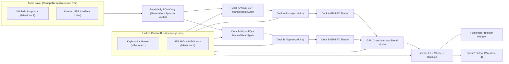

# MilkDrop VJ Project: Research and Concept Plan (Revised)

> [!NOTE]
> **About this document:** We wrote this document using **ISO 24495-1 (Plain Language)**. Every claim about external projects and libraries was verified directly against GitHub repositories, source files, and `crates.io` on **2026-11-22**.

---

## 1. Quick Summary (Decisions Locked In)

You are building a live **Video DJ (VJ)** program for Windows based on **MilkDrop**. You want to play visuals live like an instrument—similar to DJing in **Traktor** with a keyboard and mouse—and later add **USB MIDI controllers**.

| Decision Area | Locked-In Choice | Why We Chose It |
| :--- | :--- | :--- |
| **Language** | **Rust** *(fallback: C++ only if `libprojectM` on Windows blocks us)* | Delivers smooth 60 FPS visuals without garbage-collection pauses and packages into a clean native Windows app. We will heavily comment every file and explain each module in plain English in [`PROJECT_NOTES.md`](file:///c:/Users/norma/Desktop/antigravity/PROJECT_NOTES.md). |
| **Build Approach** | **Build from scratch**, borrowing proven patterns from `OpenDrop-VJ` | Keeps the codebase small, focused on your Traktor workflow, and 100% understandable—without broadcast bloat (Twitch, Kick, NDI SDK, cloud server). |
| **Visual Engine** | **`libprojectM` 4.x** (via `vcpkg` + `bindgen`) | Open-source (LGPL-2.1), actively maintained, supports multiple independent instances, and reads thousands of `.milk` presets. |
| **First Audio Input** | **WASAPI Loopback** (swappable `AudioSource` module) | Captures music playing on your laptop first; Line-In and USB audio interfaces plug into the exact same module later. |
| **Target Hardware** | **Dell Precision 7740 (NVIDIA Quadro RTX 3000)** | 6 GB VRAM, OpenGL 4.6, DirectX 12, and 4K/60 Hz outputs—with a specific BIOS/GPU routing setup documented in Section 8. |

---

## 2. Verified Research: Existing Projects and Crates

We checked every repository directly on GitHub and verified Rust packages on `crates.io` on **2026-11-22**.

### 2.1 `projectM` (`libprojectM` 4.x)

- **Repository:** [github.com/projectM-visualizer/projectm](https://github.com/projectM-visualizer/projectm) (4,594 stars, 62 open issues, last pushed 2026-11-20).
- **License:** **LGPL-2.1**. Because we link `projectM-4.dll` dynamically on Windows, our own application code can use any license (such as MIT), as long as we credit `projectM` and allow users to swap the DLL.
- **How Rust connects to it:** Do **not** rely on the `projectm` (`v3.1.2`) or `projectm-sys` (`v1.2.2`) crates from `projectm-rs`—they were last published to `crates.io` in December 2024. Instead, we will generate fresh C bindings directly from `projectM-4/projectM.h` using Rust's `bindgen` and `vcpkg`, which is proven to work on Windows.

#### Can Multiple Independent `libprojectM` 4.x Instances Run in One Process?

**Yes—with strict OpenGL context rules.** We verified this against `projectM`'s C headers ([`render_opengl.h`](https://github.com/projectM-visualizer/projectm/blob/master/src/api/include/projectM-4/render_opengl.h)) and working multi-deck Rust code ([`OpenDrop-VJ/engine/src/deck.rs`](https://github.com/kushiemoon-dev/OpenDrop-VJ/blob/main/engine/src/deck.rs) and [`gl_state.rs`](https://github.com/kushiemoon-dev/OpenDrop-VJ/blob/main/engine/src/gl_state.rs)).

- **Why this is tricky:** `libprojectM` does not own an OpenGL context. Every time we call `projectm_create()` or `projectm_opengl_render_frame()`, it runs on whichever OpenGL context is currently active on that thread. It also leaves OpenGL state modified after rendering (for example, `READ_FRAMEBUFFER_BINDING` can remain pointed at one of `projectM`'s internal buffers).
- **Two valid ways to run Deck A and Deck B:**
  1. **Per-deck shared OpenGL contexts (VERIFIED on `libprojectM 4.1.8` + Quadro RTX 3000):** Each deck gets its own OpenGL 3.3 Core context that shares textures with the main window context, plus an off-screen WGL pbuffer surface. Before calling Deck A or Deck B, we switch to that deck's context, save GL state, render with `projectm_opengl_render_frame()`, copy the pbuffer to a shared texture, insert an OpenGL fence sync (`glFenceSync` + `glFlush`), and restore GL state. Before sampling a deck's shared texture in the main or projector context, we issue a GPU-only `glWaitSync` (OpenGL 3.3 Core Spec, Chapter 5 / Section 5.3) and delete the sync object—guaranteeing cross-context ordering with zero CPU stall. Verified with `0` OpenGL errors across `8,596 frames`, crisp `1920×1080` side-by-side PNG captures, and zero visual bleed. *(Windows-specific lessons verified: host app must call `glewInit()` once before `projectm_create()`, and WGL pbuffer configs must pass `.compatible_with_native_window(raw_window_handle)`.)*
  2. **Single OpenGL context with `projectm_opengl_render_frame_fbo` (Fallback only — not needed):** As of **2026-11-22**, `projectm_opengl_render_frame_fbo()` exists **only on `projectM`'s `master` development branch** and is **not** in any officially released version (`v4.1.8` is the latest stable release). Since Pattern 1 is now verified cleanly, we stay on official `v4.1.8`.
- **Spike Hardware Findings (Dell Precision 7740 / Quadro RTX 3000 — *all performance, latency, and thermal numbers below are provisional, laptop-limited*):**
  - **10-minute synthetic-audio active stability soak (`1920×1080 × 2`, `59` preset switches, `34,587 frames`):** **`0` OpenGL errors**, **zero memory leak** (`WorkingSet` flat at `116.7 MiB` from minute 1.5 to minute 10.0; VRAM flat at `~1.2 GiB / 6 GiB`), and **zero GPU thermal clock throttling** (boosted cleanly to `1,395 MHz` at `80°C` GPU peak). *(The 10-minute live-audio WASAPI soak was approved as **deferred**, not failed; see Section 12.)*
  - **VSync timing behavior:** With VSync enabled, NVIDIA's driver waits for the previous frame's VSync at the *start* of the next frame's first OpenGL call rather than inside `swap_buffers()`. Accurate per-deck GPU render timing requires a diagnostic `--measure-gpu` mode (using `glFinish()`) or asynchronous `GL_TIME_ELAPSED` timer queries—never `glFinish()` in the normal live render loop.
  - **Heavy-preset & thermal findings (`--measure-gpu`, controlled Runs 3A/3C/3D/3E on Best Performance):** Standard presets (`01`–`06`, `09_Drawing`, `10_Dancer`) take `2–9 ms` per deck and hold a locked **`60.0 FPS`** at `1080p × 2`. Controlled runs proved that `08_Reaction`'s slowdown is caused by **`shapecode_*_num_inst`** (`3,584` instances = `22.84 ms` / `38.6 FPS`; `256` instances = `5.32 ms` / `60.0 FPS`; `4` instances = `2.64 ms` / `60.0 FPS` at `1080p`), while dropping resolution to `1280×720` saved only `0.49 ms` (`22.35 ms` / `40.0 FPS`). Split timing proved the `num_inst` cost is **roughly 50/50 CPU submission (`10.25 ms`) and GPU execution (`12.11 ms`)**—not purely CPU-bound. Sustained heavy load reached `~80°C` GPU and `90–91°C` on unidentified sensor `temp0` (fans `3,700 RPM`). **Development default on this laptop:** `1280×720` per deck, `<= 60s` test runs, Balanced power mode ok. **Milestone 2 requirements:** live FPS warning, blank-deck async downscaled warning, selectable deck resolution (`1280×720` / `1920×1080`), and a calibrated `.milk` complexity badge summing `shapecode_*_num_inst` for `enabled=1` shapes (`Light <= 100`, `Medium 101–500`, `Heavy > 500`, labeled as an estimate of CPU/draw cost).
  - **Bad-preset behavior verified:** Missing files and 0-byte empty files fire `on_preset_switch_failed` and keep the previous working preset visible; a broken `shader_body` does **not** fire the callback and silently renders a black deck (`0.0/255` luma) without crashing while the other deck stays at `60 FPS`. **Milestone 2 requirement:** Add a blank/black-deck warning indicator using a tiny downscaled asynchronous PBO readback (~2×/sec) so broken presets are spotted off-air without stalling the render loop.

---

### 2.2 `MilkDrop 3` Verification

- **Repository:** [github.com/milkdrop2077/MilkDrop3](https://github.com/milkdrop2077/MilkDrop3) (1,569 stars, 89 open issues, last pushed 2026-09-27).
- **Verified licensing and "PRO tier" details:**
  - The root repository has **no top-level LICENSE file**. Inside [`code/LICENSE.txt`](https://github.com/milkdrop2077/MilkDrop3/blob/main/code/LICENSE.txt), the C++ code carries Maxim Volskiy's **BSD 3-Clause License (2018)** inherited from BeatDrop.
  - The repository [`README.md`](https://github.com/milkdrop2077/MilkDrop3/blob/main/README.md) explicitly notes: *"A few shaders are not open-source and will only work with MilkDrop3"* and links to Patreon and BuyMeACoffee.
  - The official site ([milkdrop3.com](https://www.milkdrop3.com/)) states that the free edition is for **personal, non-remunerated use**, while a paid **PRO** license is required for commercial/remunerated use and live events (and unlocks MIDI, Spout, watermark removal, and extra presets).
- **Verdict:** Great for creative inspiration (such as its `.milk2` blending ideas), but its DirectX 9 standalone codebase and mixed licensing make it the wrong base for our custom app.

---

### 2.3 `OpenDrop-VJ` Inspection (Scratch vs. Fork Evidence)

We inspected [github.com/kushiemoon-dev/OpenDrop-VJ](https://github.com/kushiemoon-dev/OpenDrop-VJ) directly on GitHub:

- **Activity:** **23 stars**, **2 open issues**, **last pushed 2026-11-20** (actively maintained).
- **License:** **MIT License** ([`LICENSE`](https://github.com/kushiemoon-dev/OpenDrop-VJ/blob/main/LICENSE)). Its optional Ableton Link feature (`link`) pulls in GPL-2.0-or-later code (`rusty_link`), so the author keeps it **off by default**.
- **Verified features (confirmed in source files):**
  - **4 decks on `libprojectM`:** Yes (`engine/src/deck.rs`, `engine/src/compositor.rs`).
  - **MIDI, OSC, Ableton Link:** Yes (`io/src/midi/`, `io/src/osc.rs`, `io/src/osc_out.rs`, `io/src/link.rs`).
  - **Spout and NDI:** Yes (`io/src/spout.rs`, `io/src/spout_in.rs`, `io/src/ndi/`).
- **Code cleanliness and scope:**
  - The Rust code is **clean, modular, and well-commented** across five workspace crates (`core`, `engine`, `audio`, `io`, `app`).
  - However, it is a **large broadcast/streaming suite**, not a minimal Traktor-style instrument. It includes Twitch IRC chat, Kick chat WebSockets, OBS WebSocket control, a cloud preset server, phone WebSocket remote control, `ffmpeg` video clip playback, and a **mandatory build-time dependency on the external NewTek NDI SDK** (`grafton-ndi` runs `bindgen` during every build).
  - Its audio crate uses `cpal` rather than a dedicated per-deck Visual EQ and manual beat-shaping pipeline.

#### Recommendation: Build From Scratch, Borrow Proven Patterns

**Build our own app from scratch.** Forking `OpenDrop-VJ` would force you to install the NDI SDK and navigate dozens of unrelated streaming modules just to understand your own codebase. Instead, because `OpenDrop-VJ` is MIT-licensed, we can study and borrow three specific engineering lessons it already proved on Windows:
1. Binding `libprojectM 4.x` via **`vcpkg` + `bindgen`** instead of outdated wrapper crates.
2. Saving and restoring OpenGL state tightly around `projectm_opengl_render_frame()`.
3. Keeping UI (`egui`/`eframe`), core mixer state, audio, and rendering cleanly separated into small crates/modules.

---

### 2.4 Rust Crate Audit (`crates.io` Verified 2026-11-22)

| Crate | Version | Last Updated | Downloads | Status & Role in Our App |
| :--- | :--- | :--- | :--- | :--- |
| **[`wasapi`](https://crates.io/crates/wasapi)** | `0.27.0` | 2026-11-06 | 569,185 | **Actively maintained (IN USE).** Primary crate for low-latency Windows WASAPI Loopback capture. |
| **[`cpal`](https://crates.io/crates/cpal)** | `0.18.2` | 2026-08-16 | 30,172,684 | **Actively maintained.** Optional fallback for Line-In / USB audio interface capture in Milestone 4 (`wasapi` also supports `Direction::Capture`). |
| **[`egui`](https://crates.io/crates/egui) / `egui-winit` / `egui_glow`** | `0.37.0` | 2026-10-15 | 25,954,989+ | **Actively maintained (RE-VERIFIED FOR MILESTONE 2).** Directly integrates with our `winit 0.30.13`, `glutin 0.32.3`, and `glow 0.17.0` multi-context stack (we use `egui-winit` + `egui_glow` directly instead of `eframe` so we keep full control of shared OpenGL contexts and our second projector window). |
| **[`glow`](https://crates.io/crates/glow)** | `0.17.0` | 2026 | 60,957,030 | **Actively maintained (IN USE).** Exact version required by `egui_glow 0.37.0` (`^0.17.0`); thin OpenGL bindings for FBOs, sync objects, and GPU mixer/FX shaders. |
| **[`midir`](https://crates.io/crates/midir)** | `0.11.1` | 2026-10-10 | 1,230,394 | **Actively maintained.** Cross-platform USB MIDI input for Milestone 4. |
| **[`spout2-rs`](https://crates.io/crates/spout2-rs)** | `0.1.1` | 2026-06-19 | 4,112 | **Young / cautious use.** BSD-2-Clause, no linked source repo on `crates.io`, only 2 releases (`0.1.0`, `0.1.1`), though used in `OpenDrop-VJ`. Keep isolated behind a trait in Milestone 4; fall back to direct C++ Spout2 SDK bindings if needed. |

#### How OpenGL-to-Spout2 Works on Windows

Spout2 shares textures across Windows programs natively as **DirectX 11 shared textures (`ID3D11Texture2D`)**. Because `libprojectM` renders with **OpenGL**, there are two ways to send frames to Spout2:

1. **Zero-Copy GPU Interop (`WGL_NV_DX_interop` / `WGL_NV_DX_interop2`):** Maps our OpenGL texture directly to a DirectX 11 shared texture inside GPU memory—no CPU copy. Your NVIDIA Quadro RTX 3000 supports this natively. **Requirement:** Both our app and the receiving app (such as OBS or Resolume) must run on the **same GPU** (the Quadro RTX 3000), or Windows interop will fail.
2. **CPU Readback Fallback:** Reads pixels from OpenGL into RAM on a dedicated background thread and pushes them to Spout's DirectX 11 sender (this is what `OpenDrop-VJ` does in `io/src/spout.rs` via `spout2-rs` with `features = ["dx"]`). It avoids GPU interop failures at the cost of extra memory bandwidth and ~1 frame of latency.

We will defer Spout2 to **Milestone 4**, keep it behind a swappable `VideoOutput` trait, and prefer zero-copy interop with CPU readback as a fallback.

---

## 3. System Architecture (Swappable Modules)



### Swappable Audio Design and Monitoring Behavior

The audio capture module exposes one simple Rust trait (`AudioSource`) with device listing (`list_devices()`), device selection (`select_device(id)`), and stereo `f32` PCM delivery into a lock-free ring buffer:
- **Milestone 1 backend:** `WasapiLoopbackSource` (using the `wasapi` crate in event-driven loopback mode).
- **Later backend:** `LineInSource` (using `wasapi` capture mode or `cpal`) for an external DJ mixer or USB audio interface.
- Because the rest of the program only reads PCM frames from the ring buffer, switching inputs requires zero changes to `libprojectM`, Visual EQ, or the UI.

#### How WASAPI Loopback Behaves With Different DJ Setups

WASAPI loopback captures **one Windows playback (output) endpoint that you choose**—not just the system default. Our `AudioSource` UI lets you list every active Windows audio output and pick the one you want:

| Setup | What WASAPI Loopback Sees | How Our App Handles It |
| :--- | :--- | :--- |
| **Laptop speakers or single headphone jack** | Captures whatever plays on that output device. | Pick that device in our audio menu (defaults to Windows default output). |
| **USB DJ interface (Master + Headphone Cue in WASAPI Shared Mode)** | Windows exposes separate playback endpoints (or channels) for Master Out and Cue Headphones. | Select the **Master Out** endpoint in our app so headphone cueing does not trigger visuals. |
| **USB DJ interface in Exclusive ASIO Mode** | ASIO bypasses the Windows audio mixer, so WASAPI loopback receives **silence**. | Switch `AudioSource` to the **Line-In / USB Capture** backend and route a cable from the mixer's Booth/Rec Out (or use a virtual loopback driver). |
| **External hardware DJ mixer** | Audio never passes through Windows playback. | Switch `AudioSource` to the **Line-In / USB Capture** backend and plug the mixer's Rec/Booth Out into the laptop's audio input. |

---

## 4. Technical Design: Visual EQ and Manual Beat Injection

You asked how these two features work under the hood since `libprojectM` only accepts PCM audio. You were right to check: in [`projectM-4/audio.h`](https://github.com/projectM-visualizer/projectm/blob/master/src/api/include/projectM-4/audio.h), the only audio inputs are raw PCM sample functions (`projectm_pcm_add_float`, `projectm_pcm_add_int16`, `projectm_pcm_add_uint8`). There is **no direct "beat trigger" flag**.

### 4.1 Visual EQ (Does Not Affect What the Audience Hears)

- **Audience audio is untouched:** WASAPI Loopback only *copies* the audio playing on Windows. Our program never outputs sound back to your speakers or headphones.
- **How it works per deck:** Before sending PCM audio to Deck A or Deck B, our app runs a lightweight 3-band filter on that deck's private copy of the audio:
  - **Bass band:** `< 250 Hz`
  - **Mid band:** `250 Hz – 2,500 Hz`
  - **Treble band:** `> 2,500 Hz`
- Each band is multiplied by its Visual EQ gain (`0.0` to `2.0`, or `0.0` when Killed) and summed back into a modified PCM buffer passed to `projectm_pcm_add_float()`.
- **Effect on visuals:** Killing Bass on Deck A calms bass-driven zooming/throbbing on Deck A while keeping high-frequency wave motion active—and the crowd still hears full bass from the music.

### 4.2 Manual Beat Injection (Synthesized PCM Pulse + Limits)

- **How `libprojectM` measures beats (source verified):** In [`src/libprojectM/Audio/Loudness.cpp`](https://github.com/projectM-visualizer/projectm/blob/master/src/libprojectM/Audio/Loudness.cpp) and [`Loudness.hpp`](https://github.com/projectM-visualizer/projectm/blob/master/src/libprojectM/Audio/Loudness.hpp), `libprojectM` sums the lower half of the FFT spectrum into three equal slices (`Bass`, `Middles`, `Treble`). On every frame, `Loudness::UpdateBandAverage()` updates two exponential moving averages adjusted to frame rate:
  - A **short-term average** (`m_average`, decay `0.2` rising / `0.5` falling at 30 FPS).
  - A **long-term average** (`m_longAverage`, decay `0.9` for the first 50 frames, then `0.992` at 30 FPS).
  - Presets receive relative loudness as `m_current / m_longAverage` (`bass`, `mid`, `treb`) and `m_average / m_longAverage` (`bass_att`, `mid_att`, `treb_att`), centered near `1.0` (`< 0.7` quiet, `> 1.3` loud).
- **How Manual Beat works:** Pressing **Manual Beat (`Spacebar`)** mixes a short synthetic audio pulse (a damped 70 Hz low-frequency sine burst lasting ~45 ms) into the PCM buffer fed to `libprojectM`.
- **Honest technical limits:**
  1. **Long-term average adaptation:** Because relative bass is `m_current / m_longAverage`, mashing `Spacebar` rapidly raises `m_longAverage` and makes repeated pulses feel weaker until `m_longAverage` decays back down.
  2. **Preset dependency:** Some `.milk` presets react only to treble or ignore audio completely. Those presets will barely move from a bass-only PCM pulse.
  3. **Delay:** A synthesized PCM pulse takes 1–2 frames (~17–33 ms) to appear on screen.
- **Practical upgrade:** We will let the Manual Beat button optionally fire a tiny **Master Zoom-Punch** in our GPU shader at the exact same moment as the PCM pulse. That way, even audio-insensitive presets deliver a crisp visual hit when you tap `Spacebar`.

---

## 5. Control System: Conflict-Free Keyboard Layout and `mappings.json`

### 5.1 Revised Default Keyboard Layout (Zero Conflicts)

Every shortcut below is **100% remappable** through `mappings.json`. Shortcuts pause automatically whenever a text box (such as Preset Search) has focus.

| Control Group | Keys | Behavior | Notes |
| :--- | :--- | :--- | :--- |
| **Deck A Hot-Presets** | `1`, `2`, `3`, `4` | Load preset slot into Deck A | Smooth transition by default; `Shift` + key = hard cut. |
| **Deck B Hot-Presets** | `5`, `6`, `7`, `8` | Load preset slot into Deck B | Smooth transition by default; `Shift` + key = hard cut. |
| **Deck A Visual EQ Kills** | `Q` / `W` / `E` | Toggle Bass / Mid / Treble kill | Matches left-hand deck side. |
| **Deck B Visual EQ Kills** | `I` / `O` / `P` | Toggle Bass / Mid / Treble kill | Symmetric right-hand deck side. |
| **Crossfader Cuts & Nudge** | `[` / `\` / `]` and `←` / `→` | Cut A / Center / Cut B; nudge left/right | Keeps `A`/`S`/`D` free from accidental hits near `Q`/`W`/`E`. |
| **Momentary Master FX** | `Z` / `X` / `C` / `V` | Hold for Strobe / Invert / Kaleidoscope / Freeze | Releases immediately when you lift the key. |
| **Manual Beat Pulse** | `Spacebar` | Fires one synthetic beat pulse (+ optional zoom punch) | Separate from Tap Tempo. |
| **Tap Tempo** | `T` | Averages last 4 taps to set BPM | Drives synced strobe rate and timed auto-fades; never fires a beat pulse. |
| **Emergency Blackout** | `Backspace` | Smoothly fades output to black (toggle) | Safe panic button for live shows. |

### 5.2 Control Bus and `mappings.json` Schema

Every visual parameter has a stable dot-separated name (for example `mixer.crossfader`, `deck_a.eq.bass_kill`, `master.fx.strobe`) and uses normalized values from `0.0` to `1.0`. Both keyboard input and future USB MIDI input read the exact same `mappings.json` file:

```json
{
  "schema_version": 1,
  "keyboard": [
    {
      "key": "Space",
      "modifiers": [],
      "target": "audio.manual_beat",
      "mode": "trigger",
      "value": 1.0
    },
    {
      "key": "T",
      "modifiers": [],
      "target": "clock.tap_tempo",
      "mode": "trigger",
      "value": 1.0
    },
    {
      "key": "Q",
      "modifiers": [],
      "target": "deck_a.eq.bass_kill",
      "mode": "toggle"
    },
    {
      "key": "I",
      "modifiers": [],
      "target": "deck_b.eq.bass_kill",
      "mode": "toggle"
    },
    {
      "key": "Z",
      "modifiers": [],
      "target": "master.fx.strobe",
      "mode": "momentary",
      "value": 1.0
    },
    {
      "key": "BracketLeft",
      "modifiers": [],
      "target": "mixer.crossfader",
      "mode": "set",
      "value": 0.0
    },
    {
      "key": "ArrowRight",
      "modifiers": [],
      "target": "mixer.crossfader",
      "mode": "nudge",
      "step": 0.05
    }
  ],
  "midi": [
    {
      "device": "*",
      "channel": 1,
      "kind": "cc",
      "number": 1,
      "target": "mixer.crossfader",
      "mode": "continuous",
      "min": 0.0,
      "max": 1.0
    },
    {
      "device": "*",
      "channel": 1,
      "kind": "note",
      "number": 36,
      "target": "master.fx.strobe",
      "mode": "momentary",
      "value": 1.0
    }
  ]
}
```

**Supported `mode` values:**
- `trigger`: Fires a one-shot action on press.
- `toggle`: Flips between `0.0` and `1.0` on each press.
- `momentary`: Sets `value` while held, returns to `0.0` on release.
- `set`: Jumps directly to `value`.
- `nudge`: Adds `step` (positive or negative), clamped to `0.0..=1.0`.
- `continuous` *(MIDI CC)*: Maps incoming MIDI `0..=127` smoothly onto `min..=max`.

---

## 6. Preset Licensing (For Public Performances)

We checked `projectM`'s official preset repositories, including [`presets-cream-of-the-crop`](https://github.com/projectM-visualizer/presets-cream-of-the-crop/blob/master/LICENSE.md) (9,795 curated `.milk` presets by ISOSCELES):

- **What the official `LICENSE.md` says:** Most classic MilkDrop presets were posted freely on Winamp forums over the past 20+ years without a formal license file. Strictly speaking, each original author still holds copyright unless they stated otherwise. The `projectM` team treats them as effectively public domain for visualization playback and removes any preset if an author requests it.
- **What this means for you:**
  - **Live club / local DJ gigs:** Widely used across the VJ community (projectM, NestDrop, MilkDrop). Do **not** resell the preset pack itself.
  - **Paid commercial broadcasts or strict client contracts:** Maintain a separate folder (for example `presets/licensed/`) containing only presets you wrote yourself or presets with an explicit MIT / CC0 license. Our preset browser will let you filter by folder/tag so you can switch cleanly to a verified-license set anytime.

---

## 7. Latency Targets (Audio-to-Visual and Control-to-Visual)

Live visuals feel "locked to the music" when total delay stays under **~50 milliseconds (ms)**. Anything above **70 ms** starts to feel sluggish on fast drum hits.

| Stage | Target Budget | Notes |
| :--- | :--- | :--- |
| WASAPI Loopback audio capture | **10–15 ms** | Event-driven shared mode (Windows default period is ~10 ms). |
| Visual EQ + Beat Synth + Ring Buffer | **< 1 ms** | Runs in plain `f32` math on the audio thread; no memory allocations. |
| `libprojectM` + GPU Mixer + FX (60 FPS) | **16.7 ms** | 1 render frame. Both decks share the Quadro RTX 3000. |
| Display scanout / VSync | **8–16.7 ms** | Depends on projector refresh rate (60 Hz = 16.7 ms). |
| **Total Audio-to-Visual Target** | **35–50 ms** | **Hard ceiling: 70 ms.** |
| **Keyboard / Mouse-to-Visual Target** | **< 33 ms** | Response visible within 2 frames at 60 FPS. |

**Milestone 1 measurement status (provisional, laptop-limited):**
- **Measured inside the app (Stage B Run #2, Balanced power):** Internal `audio_age` averaged **`23.12 ms`** (`22.0–22.3 ms` steady at 60 FPS; worst `168.60 ms` during a brief 28 FPS dip). `audio_age` starts from **WASAPI packet arrival** (minus packet duration) to `projectm_pcm_add_float()`—it does **not** start from original sound production.
- **Assumed / not yet directly measured:** GPU render (`~5–8 ms`), VSync scanout (`~8–16.7 ms`), upstream media-player/Windows mixer buffering, and monitor/projector pixel response. Adding the measured `22–23 ms` to assumed render + VSync gives an **estimated `~35–48 ms`** (not yet verified end-to-end; full retest on better hardware is listed in Section 12).

---

## 8. Display and Multi-Monitor Handling (Dell Precision 7740)

The **Dell Precision 7740** has both an **Intel integrated GPU (iGPU)** and an **NVIDIA Quadro RTX 3000 discrete GPU (dGPU)**. On dual-GPU Windows laptops, an OpenGL app can accidentally run on the Intel iGPU or copy rendered frames across GPUs to reach an external display.

### What Is Verified vs. Unverified for the Precision 7740

- **Verified:** Official Dell Precision 7740 documentation ([Dell Precision 7740 Documentation](https://www.dell.com/support/home/en-us/product-support/product/precision-17-7740-laptop/docs)) lists a BIOS setting under **Video → Switchable Graphics** (Enable / Disable) to control hybrid graphics (NVIDIA Optimus).
- **UNVERIFIED (marked for live hardware testing later):**
  1. Whether the Precision 7740 BIOS includes a separate *"Discrete Graphics Controller Direct Output Mode"* toggle (that exact option is documented on newer models such as the Precision 7550/7750, and could not be verified in the Precision 7740 manual).
  2. Exactly which GPU physically drives the HDMI 2.0, Mini DisplayPort 1.4, and Thunderbolt 3 ports on the Precision 7740 when Switchable Graphics is enabled.
- **Current Plan (No BIOS Changes Needed Now):** Do **not** change any BIOS settings yet. Once we build Milestone 1, our app will print the active OpenGL `GL_RENDERER` string (so we can confirm whether Windows picked the Quadro RTX 3000 or Intel iGPU) and we will test external display lag directly on real hardware. If Windows picks the Intel iGPU, the first fix is simply assigning our `.exe` to **High Performance (NVIDIA Quadro RTX 3000)** in Windows Graphics Settings.

### App-Side Multi-Monitor Design

- **Startup GPU Verification:** Our app will log and display the active `GL_RENDERER` string in the status bar (for example `NVIDIA Quadro RTX 3000`) and show a clear warning banner if it detects `Intel` graphics.
- **Two Windows:**
  - **Window 1 (Control Console):** Stays on your laptop screen with Deck A preview, Deck B preview, Master preview, crossfader/mixer, preset browser, and status bar.
  - **Window 2 (Projector Output):** Borderless fullscreen window placed on whichever external monitor you select, with a one-click monitor picker and an internal render resolution toggle (for example render at `1280×720` or `1920×1080` even if plugged into a `4K` TV so frame rates stay smooth).
  - **Two-Window Swap Interval Rule (VSync):** In a single-threaded multi-window OpenGL loop, enabling VSync (`SwapInterval::Wait(1)`) on *both* windows can serialize two VSync waits per frame and halve FPS to `30 FPS`. Therefore, only **one** window waits on VSync at a time:
    - **Single-window mode (no projector open):** Control Console uses `SwapInterval::Wait(1)`.
    - **Dual-window mode (projector open):** Projector Output uses `SwapInterval::Wait(1)` (so the audience display stays tear-free and locked to projector refresh) while the Control Console switches to `SwapInterval::DontWait` (it still runs at the projector's 60 Hz pace with zero double-VSync penalty).

---

## 9. Risk Register

| Risk | Likelihood | Impact | Mitigation |
| :--- | :--- | :--- | :--- |
| **1. Multi-instance `libprojectM` OpenGL state conflicts** | Medium | High | Test two `libprojectM 4.1.8` instances using **Pattern 1** (per-deck shared OpenGL contexts + full GL state save/restore) as the **first task in Milestone 1**. Only revisit an unreleased `master` overlay port (`projectm_opengl_render_frame_fbo`) if Pattern 1 shows unfixable bleed or state bugs. |
| **2. Windows `libprojectM` build friction (`vcpkg` + `bindgen`)** | Medium | High | Use the proven `vcpkg` `x64-windows` dynamic triplet + `bindgen` pattern. If it becomes a major blocker, reconsider C++ as agreed. |
| **3. Precision 7740 Intel iGPU routing / Optimus stutter** | Medium | Medium | Print `GL_RENDERER` on startup, warn if Intel is active, set Windows High-Performance GPU rule, and test external monitor lag directly before considering BIOS changes. |
| **4. Broken or ultra-heavy `.milk` preset freezes live output** | High | High | Wrap preset loads cleanly, show load errors without crashing, monitor FPS, and let the user mark/hide bad presets. |
| **5. WASAPI Loopback stops sending packets during silence** | High | Medium | Known Windows behavior! When no loopback packets arrive, feed zeroed silence buffers (+ any manual beat pulses) so visuals stay alive at 60 FPS between songs. |
| **6. `spout2-rs` crate goes unmaintained (`v0.1.1`)** | Medium | Low | Keep Spout in Milestone 4 behind a clean `VideoOutput` trait; replace with direct C++ Spout2 SDK bindings if needed. |
| **7. Rust learning curve slows iteration** | Medium | Medium | Keep architecture simple (no complex async runtime needed in core/UI), comment every file thoroughly, and document every module in [`PROJECT_NOTES.md`](file:///c:/Users/norma/Desktop/antigravity/PROJECT_NOTES.md). |
| **8. Preset-load & shader-compile stall (off-air load stalls on-air deck)** | High | Medium | **Plain fact (verified in `ProjectM.cpp` lines 56–67):** Because rendering is single-threaded and `projectm_load_preset_file()` parses files and compiles OpenGL shaders synchronously on the calling thread, **loading a preset on the off-air deck also briefly stalls the on-air deck** (`~7–25 ms` on warm NVIDIA shader cache, longer on a true cold compile). **Measurement in Milestone 2:** Normal runs will automatically log the frame containing each preset load plus the next two frames for both decks so real stall impact is visible without a separate stress test. **Options:** (1) Accept small warm-cache hitches as minor; (2) cue/preload new presets on the off-air deck during a quiet musical moment or breakdown; (3) flag slow-loading presets in the browser; (4) only if hitches prove visibly distracting live, evaluate moving each deck's shared OpenGL context onto its own worker thread in a later milestone. |

---

## 10. Updated Four-Milestone Roadmap & Scope Agreement

### Feature-to-Milestone Scope Table

| Feature (from Sections 3–8) | Milestone | Notes |
| :--- | :---: | :--- |
| Dual `libprojectM 4.1.8` OpenGL engine + `AudioSource` + WASAPI Loopback + lock-free ring buffer | **Milestone 1 (Complete)** | Accepted complete (`10-min` live-audio soak **deferred** to Section 12). |
| **Control Bus (`0.0..=1.0`) + `mappings.json` + remappable keyboard shortcuts** | **Milestone 2 (`2A-1`, `2A-3`)** | Built **first** before UI widgets so `egui`, keyboard, and future MIDI share one bus from day one. |
| Dark-venue `egui` console, Deck A/B/Master previews, FPS display, blank-deck async warning, `glFenceSync`/`glWaitSync` | **Milestone 2 (`2A-1`)** | Plus preset-load + next-2-frames logging in normal runs. |
| GPU Mixer (Crossfader + 5 Blend Modes: Crossfade, Additive, Multiply, Difference, Luma Wipe) | **Milestone 2 (`2A-2`)** | Driven through the Control Bus. |
| Preset Browser (background scan + disk cache, search, calibrated complexity badge, Deck A/B load) | **Milestone 2 (`2A-4`)** | Tested with a few hundred presets (gitignored). |
| Top Bar (audio device dropdown w/ non-blocking restart, Live/Test switch, runtime resolution toggle) | **Milestone 2 (`2A-5`)** | Default `1280×720` during dev; 5-toggle test now, 20-toggle on Section 12 list. |
| Borderless Fullscreen Projector Output Window (2nd monitor + swap-interval rule) | **Milestone 2 (`2B`)** | 30–60s test on a real external monitor. |
| **Per-deck 3-band Visual EQ & Kill switches (`Q`/`W`/`E`, `I`/`O`/`P`)** | **Milestone 3** | **Not in Milestone 2.** |
| **Manual Beat Pulse (`Spacebar`) & Tap Tempo (`T`)** | **Milestone 3** | **Not in Milestone 2.** |
| **Two GPU Effect Racks (Hue, Mirror/Kaleidoscope, Invert, Strobe, Freeze, Blackout)** | **Milestone 3** | **Not in Milestone 2.** |
| **Hot-Preset Banks (`1`–`8`)** | **Milestone 3** | **Not in Milestone 2.** |
| **Line-In / USB audio interface input (`AudioSource` backend #2)** | **Milestone 4** | **Not in Milestone 2.** |
| **USB MIDI (`midir`) + one-click MIDI Learn** | **Milestone 4** | **Not in Milestone 2** (Control Bus + `mappings.json` already ready). |
| **Spout2 Output (`VideoOutput` trait) & Preset License-Folder Filtering** | **Milestone 4** | **Not in Milestone 2.** |

### Milestone Details

1. **Milestone 1 — Dual-Instance Spike + WASAPI Live Audio (COMPLETE)**
   - Proved two independent `libprojectM 4.1.8` instances on the Quadro RTX 3000 using **Pattern 1** (`0` GL errors, flat memory in 10-minute synthetic soak).
   - Built the swappable `AudioSource` trait, `WasapiLoopbackSource`, `TestAudioSource`, and lock-free SPSC ring buffer feeding live music to both decks.
   - *Deferred (not failed):* 10-minute live-audio soak (see Section 12).
2. **Milestone 2 — Control Bus, Dual-Deck Traktor Console & Projector Output (6 Sub-Stages)**
   - **`2A-1`:** `egui` dark-venue window with Deck A & Deck B previews, FPS display, blank-deck async warning, `glFenceSync`/`glWaitSync`, preset-load + next-2-frame logging, and the **Control Bus (`0.0..=1.0`) + `mappings.json`** (no mixer yet).
   - **`2A-2`:** GPU mixer, Master preview, crossfader, and 5 blend modes wired through the Control Bus.
   - **`2A-3`:** Remappable keyboard mapping through the Control Bus (keyboard-first controls, remappable from the start).
   - **`2A-4`:** Preset browser (background scanner + disk cache, search, calibrated complexity badge, load to Deck A or Deck B).
   - **`2A-5`:** Top bar (audio device dropdown with unplug-safe non-blocking restart, Live/Test source switch, runtime resolution toggle).
   - **`2B`:** Borderless fullscreen Projector Output window on a second monitor.
3. **Milestone 3 — Human-in-the-Loop Performance Controls**
   - Add per-deck 3-band Visual EQ + Kill switches, Manual Beat Pulse (`Spacebar`), Tap Tempo (`T`), two GPU Effect Racks (Hue, Mirror/Kaleidoscope, Invert, Strobe, Freeze, Blackout), and Hot-Preset banks (`1`–`8`)—all wired into the existing Control Bus.
4. **Milestone 4 — Hardware & Pro Extensions**
   - Add Line-In / USB audio interface input (`AudioSource` backend #2).
   - Add USB MIDI (`midir`) + one-click MIDI Learn writing to `mappings.json`.
   - Add Spout2 output (`VideoOutput` trait) and preset tagging/licensing folders.

---

## 11. Windows Paths and Toolchain Install Plan

### Chosen Directory Layout
- **Code repository:** `C:\dev\vj\` (short path, outside OneDrive).
- **`vcpkg` root (`VCPKG_ROOT`):** `C:\vcpkg` (short path, outside OneDrive).
- **Continuous notes:** [`C:\Users\norma\Desktop\antigravity\PROJECT_NOTES.md`](file:///c:/Users/norma/Desktop/antigravity/PROJECT_NOTES.md) (kept where it is, as requested).

### Exact Install Order, Commands, and Admin/Restart Notices

Our current terminal is running as a **standard user (`IsAdmin: False`)**. Steps marked **Admin (UAC)** will trigger a Windows User Account Control prompt when run:

| Order | Tool | Exact Command | Admin (UAC) / Restart? |
| :---: | :--- | :--- | :--- |
| **1** | **Git for Windows** (`2.56.1`) | `winget install -e --id Git.Git --scope user --accept-package-agreements --accept-source-agreements` | **No admin** if `--scope user` (or **Admin UAC** if machine-wide). No restart. |
| **2** | **Visual Studio 2022 Build Tools** (`17.14.45` + C++ workload) | `winget install -e --id Microsoft.VisualStudio.2022.BuildTools --accept-package-agreements --accept-source-agreements --override "--passive --wait --norestart --add Microsoft.VisualStudio.Workload.VCTools;includeRecommended"` | **Requires Admin (UAC).** May flag a **pending restart** (we pass `--norestart` so it will not reboot automatically). |
| **3** | **CMake** (`4.4.4`) | `winget install -e --id Kitware.CMake --accept-package-agreements --accept-source-agreements` | **Requires Admin (UAC).** No restart. |
| **4** | **LLVM / Clang** (`23.1.6`) + `LIBCLANG_PATH` | `winget install -e --id LLVM.LLVM --accept-package-agreements --accept-source-agreements` (then set user env `LIBCLANG_PATH=C:\Program Files\LLVM\bin`) | **Requires Admin (UAC).** No restart. |
| **5** | **Rust (`rustup`)** (`1.29.3`, `stable-x86_64-pc-windows-msvc`) | `winget install -e --id Rustlang.Rustup --accept-package-agreements --accept-source-agreements` (then verify/ensure `stable-x86_64-pc-windows-msvc`) | **No admin needed** (user profile). No restart. |
| **6** | **`vcpkg`** + `VCPKG_ROOT` | `git clone https://github.com/microsoft/vcpkg C:\vcpkg` → `C:\vcpkg\bootstrap-vcpkg.bat` → set user env `VCPKG_ROOT=C:\vcpkg` | **No admin needed** (`C:\` allows Authenticated Users to create folders). No restart. |

---

## 12. Light-Load Development Rules and Retest on Better Hardware

### Light-Load Rules (Active on the Dell Precision 7740)
- Keep test runs to **60 seconds or less**, apart from functional checks that need longer.
- **No** soak tests, **no** 120-second heavy-preset runs, and **no** repeated max-load runs on this laptop.
- Plugged in + **Balanced** power mode is fine for functional testing. Use **`1280×720` per deck** by default while developing.
- Label any performance, latency, or thermal number from this laptop **"provisional, laptop-limited"**.

### Retest on Better Hardware
Re-run the following tests once stronger hardware is available:
1. **10-minute live-audio soak** with real music and preset switching across both decks.
2. **Heavy-preset timings (Runs 3A and 3C to 3E)** at `1920×1080`.
3. **Audio-to-visual latency**, with measured parts (`audio_age` from WASAPI packet arrival, GPU render time) and assumed/unmeasured parts (upstream player buffer, VSync, display lag) listed separately.
4. **Thermals and GPU clock behavior** over a long run (including named CPU sensor identification).
5. **Projector output:** which GPU drives the external display, lag, and VSync behavior.
6. **Full preset library scan time** across the full `presets-cream-of-the-crop` library (~9,795 presets).
7. **Resolution toggle stress test:** 20 runtime resolution toggles in a row (checking GL errors and memory growth).

*(Append additional items here as later milestones uncover hardware-limited checks.)*
